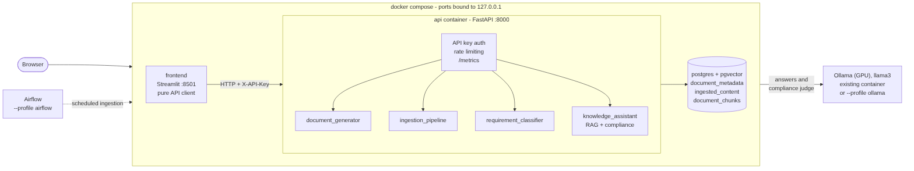

# AI Solution Architect Portfolio

An enterprise-grade AI platform built incrementally as a learning journey
and professional portfolio, using exclusively open-source technologies
and synthetic data. **All seven phases of the original roadmap are
complete, plus three post-roadmap extensions** (web frontend, compliance
validation, containerized deployment).



## Philosophy

- **Open Source First**: self-hostable software is prioritized over
  proprietary cloud services.
- **Learn by Building**: every concept learned from a technical book is
  translated into a real implementation within the platform.
- **Architecture Before Code**: every significant feature is designed
  (problem statement, requirements, diagram, ADR) before implementation.
- **Documentation as Code**: documentation is a deliverable, not an
  afterthought.

## Current status

See [`docs/architecture/SYSTEM_OVERVIEW.md`](docs/architecture/SYSTEM_OVERVIEW.md)
for the full picture of how everything fits together.

| Phase | What it proved | Real result |
|---|---|---|
| 1 — Document Generator | Realistic synthetic data generation | 3 document types, category-correlated text |
| 2 — Ingestion Pipeline | Orchestrated extraction (Apache Airflow) | Idempotent, fault-isolated |
| 3 — Requirement Classifier | Classical ML on real extracted content | 83.5% accuracy vs. 17.5% baseline |
| 4 — Knowledge Assistant | Local, self-hosted RAG | GPU-accelerated, verified anti-hallucination |
| 5 — Performance Lab | Evidence-based optimization | 15.3x / ~6.4x measured speedups |
| 6 — Document Understanding | Honest model comparison | Simpler model won — confirmed, not assumed |
| 7 — Product Hardening | Unified, authenticated, observable API | Validated over real HTTP, CI per module |
| 8 — Web Frontend | A usable interface without duplicating logic | Streamlit client; API key never reaches the browser |
| 9 — Compliance Validation | Grounded checks of RFP requirements against product manuals | Accuracy 0.89 (F1 0.91) with an LLM judge vs. 0.755 with retrieval alone, on synthetic data |
| 10 — Containerized Deployment | One-command, reproducible stack | `docker compose up`; rate limiting; smoke-tested in CI |

## Quick start (Docker)

Requirements: Docker with Compose, and an [Ollama](https://ollama.com)
server reachable from containers (GPU recommended) with the `llama3` model.

```bash
# 1. Configure (the API key is required; there is no default)
cp .env.example .env
#    edit .env and set API_KEY, e.g. the output of: openssl rand -hex 24

# 2. Start PostgreSQL + API + frontend
docker compose up -d --build --wait

# 3. Check it
export API_KEY=$(grep '^API_KEY=' .env | cut -d= -f2)
scripts/smoke.sh
```

Open <http://localhost:8501>. On an empty database, use the **Pipeline**
page in this order: generate `rfp` and `technical_manual`, ingest, index.
Then try **Ask**, **Classify** and **Compliance**.

The API reads the LLM from `OLLAMA_BASE_URL` (default
`http://host.docker.internal:11434`, i.e. an Ollama already running on
the host). Without one, start the bundled GPU service instead:

```bash
# in .env:  OLLAMA_BASE_URL=http://ollama:11434
docker compose --profile ollama up -d --build --wait
docker compose exec ollama ollama pull llama3
```

Optional profile: `--profile airflow` adds the Airflow orchestration used
in Phase 2/5. All ports are bound to `127.0.0.1`: the frontend has no
login, so do not expose it to a network.

## Quick start (local development, without Docker for the app)

```bash
# 1. PostgreSQL (with pgvector) only
docker compose up -d postgres

# 2. Generate the synthetic document corpus (Phase 1)
cd backend
uv sync
uv run document-generator generate --document-type rfp --count 10
uv run document-generator generate --document-type excel_requirements --count 20
uv run document-generator generate --document-type technical_manual --count 10

# 3. Ingest (Phase 2/5)
cd ingestion_pipeline && uv sync
uv run ingestion-pipeline ingest --parallel

# 4. Classify (Phase 3/6)
cd ../requirement_classifier && uv sync
uv run requirement-classifier compare

# 5. Index and query the knowledge assistant (Phase 4/5)
cd ../knowledge_assistant && uv sync
uv run knowledge-assistant index

# 6. Compliance check of one RFP against the manuals (Feature 0009)
uv run knowledge-assistant compliance-check --rfp rfp_0000.pdf
uv run knowledge-assistant compliance-evaluate --judge-sample 50

# 7. Run everything behind one authenticated API (Phase 7)
cd ../api && uv sync
cp .env.example .env   # set a real API_KEY
uv run uvicorn portfolio_api.main:app --port 8000

curl http://localhost:8000/health
curl -X POST http://localhost:8000/assistant/ask \
  -H "X-API-Key: <your key>" -H "Content-Type: application/json" \
  -d '{"question": "What is the budget range mentioned in the proposals?"}'
```

Web interface, with the API running:

```bash
cd frontend
cp .env.example .env     # API_KEY must match backend/api/.env
uv sync
uv run streamlit run src/portfolio_frontend/app.py
```

Open <http://localhost:8501>.

## Repository structure

```
.
├── .github/workflows/   # CI: one job per module + a Docker smoke job
├── docker-compose.yml   # postgres + api + frontend (profiles: ollama, airflow)
├── .env.example         # configuration for docker compose
├── scripts/smoke.sh     # end-to-end smoke check of the running stack
├── docs/                # Architecture documentation, ADRs, diagrams, release notes
│   └── architecture/SYSTEM_OVERVIEW.md   # Start here
├── backend/             # Six independent uv projects
│   ├── src/document_generator/       # Phase 1
│   ├── shared_core/                  # Shared table definitions (ADR-0006), capability catalog (ADR-0008)
│   ├── ingestion_pipeline/           # Phase 2/5
│   ├── requirement_classifier/       # Phase 3/6
│   ├── knowledge_assistant/          # Phase 4/5, compliance engine (Feature 0009)
│   ├── api/                          # Phase 7: unifies all of the above
│   └── datasets/                     # Synthetic data (never real/confidential information)
├── infrastructure/      # Airflow configuration
└── frontend/            # Streamlit client of the API (Feature 0008)
```

## Known limitations and future work

See the *Future work* section of the
[system overview](docs/architecture/SYSTEM_OVERVIEW.md#future-work).

## License

This project is distributed under the MIT License. See [LICENSE](LICENSE).

## Disclaimer

All business content (RFPs, requirements, datasets) is synthetic and
fictional (fictional company "Andes Digital Networks"). No confidential
or proprietary information is used.
