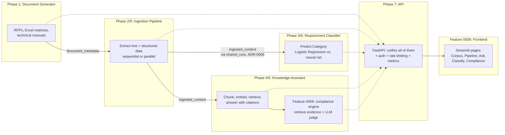

# System Overview

A guide for anyone encountering this repository for the first time:
what this platform does, how its parts fit together, and where
to find the detailed design behind each piece.

## What this is

A self-hosted, open-source AI platform that generates synthetic
enterprise documents, extracts and understands their content, answers
questions about them, and checks RFP requirements against product
documentation — built incrementally as a structured learning journey,
with every feature designed before it was coded (see
`docs/architecture/adr/` and `docs/architecture/features/`).

## How the phases connect

**The corpus flows in one direction**: Phase 1 generates it, Phase 2
extracts it into two shared tables (`document_metadata`,
`ingested_content` — the single source of truth defined in
`shared_core`, ADR-0006), and Phases 3 and 4 both read from that same
extracted content independently, for two different purposes
(classification and retrieval-augmented answering). The compliance
engine reuses the retrieval layer, restricted to technical manuals. The
API doesn't add a new capability — it is the front door to the ones that
already exist, and the frontend is a pure client of that API.

## Deployment view

The default `docker compose up` starts PostgreSQL (pgvector), the API and
the frontend. The LLM (Ollama, GPU) is reached by URL: an existing
container or host service, or the optional `ollama` profile. Airflow is
the optional `airflow` profile. Only `127.0.0.1` ports are published.
Diagram source: `docs/diagrams/system-architecture.mmd`.

## The independent projects

| Project | Phase(s) | Owns | Reads |
|---|---|---|---|
| `backend/` (document_generator) | 1 | `document_metadata` | — |
| `backend/shared_core/` | — (ADR-0006, ADR-0008) | Table definitions, capability catalog | — |
| `backend/ingestion_pipeline/` | 2, 5 | `ingested_content` | `document_metadata` |
| `backend/requirement_classifier/` | 3, 6 | Model artifacts | `ingested_content` |
| `backend/knowledge_assistant/` | 4, 5, 0009 | `document_chunks` | `ingested_content`, `document_metadata` |
| `backend/api/` | 7, 0010 | — | Calls into all of the above |
| `frontend/` | 0008 | — | The API only |

Each is its own `uv` project with its own virtual environment and
dependencies (ADR-0003) — Faker and fpdf2 have no reason to be
installed alongside sentence-transformers and scikit-learn. The
recurring cost of that isolation (a workspace auto-discovery quirk hit
three times, documented in ADR-0003) was worth paying once each new
module made a genuine dependency-isolation problem real, rather than
merging everything into one project to avoid the friction.

## Phase-by-phase, with real results

| Phase | What it proved | Real result |
|---|---|---|
| 1 | Synthetic data generation with realistic structure | 3 document types, category-correlated text (ADR-0004) |
| 2 | Orchestrated extraction (Apache Airflow) | Idempotent, fault-isolated ingestion |
| 3 | Classical ML on the extracted content | 83.5% accuracy vs. 17.5% baseline |
| 4 | Local, self-hosted RAG | GPU-accelerated grounded answers, verified anti-hallucination |
| 5 | Evidence-based performance optimization | 15.3x (embedding batching), ~6.4x (parallel ingestion) |
| 6 | Honest model comparison | Logistic Regression beat a neural network — confirmed, not assumed |
| 7 | Productization | Unified API, auth, metrics, CI |
| 8 | A usable interface without duplicating logic | Embedding model loaded once per process: warm `/ask` 4.5 s to 1.9 s (indicative, n=1) |
| 9 | Grounded compliance checks | Accuracy 0.890, F1 0.911 with the LLM judge vs. 0.755 / 0.821 retrieval-only (sample of 200, synthetic data) |
| 10 | Reproducible deployment | One command starts the stack; images: API 3.99 GB, frontend 1.28 GB |

## The web frontend (v0.8.0, extended in v0.9.0)

`frontend/` is a Streamlit application that consumes the API over HTTP. It
contains no business logic: every page calls a typed `ApiClient`, and the
API key lives only on the Streamlit server. Five pages cover the
platform: Corpus (status and counts), Pipeline (generate / ingest /
index), Ask (grounded answers with readable sources), Classify
(requirement classification and model comparison) and Compliance (RFP
requirements checked against the manuals, with the supporting passages).
A rate-limited request is shown as "try again in N seconds". See
`docs/architecture/features/0008-web-frontend.md`.

## Compliance validation (Feature 0009)

For each requirement of an RFP, the engine retrieves passages from the
technical manuals only. If nothing reaches the similarity threshold, the
verdict is `NOT_EVIDENCED` without calling the LLM (groundedness first).
Otherwise a local LLM judge, run at temperature 0, answers in strict JSON;
anything unparseable becomes `NEEDS_REVIEW`. Ground truth comes from a
capability catalog (ADR-0008): the manuals are generated from a supported
subset and the RFP requirements from a larger vocabulary, so the right
answer is known. Retrieval alone is limited by precision (0.665 at the
best threshold), not recall; the judge is what separates "talks about the
topic" from "guarantees this". The tool supports a human decision and says
so on the page. See `docs/architecture/features/0009-compliance-validation.md`
for the honest limitations (synthetic data, threshold selected on the
evaluation data, a persistent judge error on out-of-catalog requirements).

## Containerized deployment (Feature 0010)

Two images (API with the embedding model baked in and CPU-only torch;
frontend without torch), a compose file with profiles, secrets from the
environment (the API refuses to start without `API_KEY`), non-root
containers and healthchecks. The API applies a token-bucket rate limit per
API key in two tiers: a default tier for all protected routes and a
stricter one for the routes that call the LLM or heavy pipelines. A
`scripts/smoke.sh` check runs locally and in a dedicated CI job. See
`docs/architecture/features/0010-containerized-deployment.md`.

## Future work

Ordered by expected value, none of them needed for the platform to work:

- **Judge quality.** Require that the judge's quoted sentence appears
  verbatim in the cited passage; compare a larger local model on the same
  200-requirement sample (the model is a configuration value).
- **Honest evaluation.** Hold out part of the requirements to choose the
  similarity threshold instead of selecting it on the evaluation data.
- **Observability.** Grafana dashboards over the existing Prometheus
  `/metrics` endpoint (including `api_rate_limited_total`).
- **Document understanding.** OCR and table extraction for real scanned
  PDFs; the synthetic corpus does not need them.
- **Security.** Login for the frontend; throttling of failed API-key
  attempts by client address; a Redis-backed rate limiter if the API ever
  runs with several workers.
- **Operations.** Asynchronous jobs for long operations; path-aware
  ingestion so regenerated documents replace the old rows (see the stale
  duplicates found in Feature 0009); a slimmer API image (3.99 GB today).
- **Platform.** Kubernetes/Helm manifests, if a multi-host deployment ever
  becomes a goal.

## Where to go next

- **A specific decision's reasoning**: `docs/architecture/adr/` (one ADR
  per significant architectural choice).
- **A specific feature's full design**: `docs/architecture/features/`
  (one document per feature, including real implementation notes added
  after building each).
- **What changed in each release**: `docs/releases/` (`v0.1.0` through
  `v0.9.0`), or the GitHub Releases page for the same content with
  working cross-links.
- **How to run it yourself**: the root `README.md`'s Quick Start.
